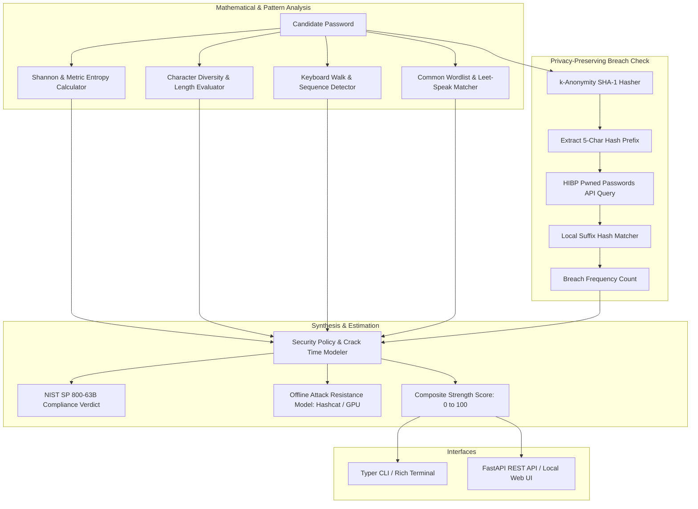

# Password Intelligence Analyzer (`password-analyzer`)

Enterprise Password Intelligence, Shannon Entropy Evaluator, Combinatorial Crack-Time Modeler, NIST SP 800-63B Policy Verifier, and HaveIBeenPwned k-Anonymity Integration.

[](https://github.com/Krish9800/password-analyzer/actions)
[](LICENSE)
[](https://www.python.org/)
[](https://pages.nist.gov/800-63-3/sp800-63b.html)
[](https://haveibeenpwned.com/API/v3#PwnedPasswords)

---

## Overview & Problem Statement

Weak, reused, and compromised passwords remain the root cause of credential-stuffing breaches. Legacy password policies that mandate arbitrary special characters or frequent expiration frequently encourage predictable patterns (e.g. `Password123!`), while modern standards (NIST SP 800-63B) advocate for length, entropy, and checking against known breach corpuses.

**Password Intelligence Analyzer** is a privacy-preserving credential evaluation engine. It computes mathematical Shannon entropy, detects keyboard walk patterns, checks compliance with NIST SP 800-63B, models offline crack times against multi-GPU clusters, queries the HaveIBeenPwned API via privacy-preserving **k-Anonymity**, and provides an interactive local web dashboard.

---

## Architecture & Data Flow



---

## Verified Features

- **Mathematical Entropy Calculation:** Computes true Shannon entropy and metric entropy based on character set pools and information theory.
- **Pattern & Heuristic Detection:** Identifies sequential runs (`123456`, `abcdef`), keyboard walks (`qwerty`, `asdfgh`), repeated characters (`aaaaa`), and common leet-speak substitutions (`p@ssw0rd`).
- **NIST SP 800-63B Verification:** Validates against modern guidelines (minimum length, absence of truncated spaces, no forced character composition rules).
- **k-Anonymity Breach Checks:** Safely queries HaveIBeenPwned by submitting only the first 5 characters of the SHA-1 hash; the plain password never leaves the machine.
- **Offline Crack-Time Estimation:** Calculates estimated brute-force resistance across single CPU, consumer GPU, and enterprise multi-GPU cracking clusters.
- **Dual Interface:** Typer CLI with terminal formatting, plus an embedded FastAPI service with an interactive local web dashboard.

---

## Technology Stack

- **Runtime:** Python 3.12+
- **HTTP Client:** HTTPX (for k-Anonymity API queries)
- **Data Models:** Pydantic v2
- **CLI Framework:** Typer & Rich
- **API & UI Framework:** FastAPI & Jinja2 HTML templates
- **Testing:** Pytest, Ruff, Mypy, Bandit

---

## Requirements & Installation

```bash
# Clone the repository
git clone https://github.com/Krish9800/password-analyzer.git
cd password-analyzer

# Create and activate virtual environment
python3 -m venv .venv
source .venv/bin/activate

# Install dependencies
pip install -e .
```

---

## Verified Usage Examples

### 1. Command-Line Interface (CLI)

```bash
# Analyze a candidate password for strength and entropy
password-analyzer analyze "CorrectHorseBatteryStaple!"

# Analyze with breach database check enabled
password-analyzer analyze "P@ssw0rd123" --check-breaches

# Check CLI version
password-analyzer version
```

### 2. Local Web Dashboard & REST API

```bash
# Launch the local web dashboard and REST API
password-analyzer serve --host 127.0.0.1 --port 8000
```

Open `http://127.0.0.1:8000` in your browser to access the local interactive evaluation UI, or explore OpenAPI documentation at `http://127.0.0.1:8000/docs`:
- `GET /` — Local web evaluation interface
- `POST /api/v1/analyze` — Programmatic credential analysis endpoint
- `GET /health` — Service health status

---

## Testing & Quality Gates

```bash
# Run unit and entropy calculation tests
pytest --cov=password_analyzer --cov-report=term-missing

# Linting and static analysis
ruff check .
ruff format --check .
mypy src/password_analyzer
```

---

## Security Model & Privacy Guarantees

- **k-Anonymity Architecture:** When checking breach databases, the full password is never sent over the wire. Only a 5-character SHA-1 prefix is transmitted, and matching is completed locally.
- **Zero Disk Persistence:** Analyzed passwords are evaluated strictly in transient memory and are never logged, persisted to disk, or stored in history files.
- **Local Isolation:** The web dashboard runs on localhost without tracking cookies, external CDN scripts, or third-party telemetry.

---

## Limitations & Known Issues

- **Offline Mode:** When network access is disabled, k-Anonymity breach checking is skipped and analysis relies on local dictionary and heuristic evaluation.
- **Custom Corporate Dictionaries:** Incorporating internal organization-specific wordlists requires passing a custom dictionary file path.

---

## License & Responsible Use

This project is licensed under the **MIT License** — see the [LICENSE](LICENSE) file for details.

> [!NOTE]
> Designed for security researchers, authentication system designers, and credential auditing.
